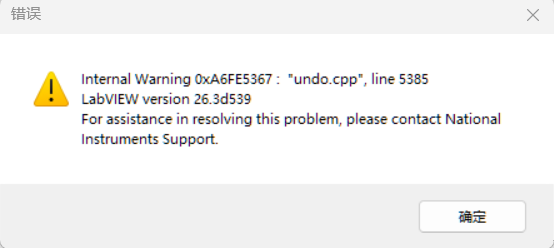

> [!NOTE]
> This tool is a companion watchdog for [labview-mcp](https://github.com/NEVSTOP-LAB/labview-mcp). When LabVIEW is
> blocked by an `Internal Warning` / `Internal Error` dialog, the MCP call never returns and later calls cannot reach
> LabVIEW either. The watchdog dismisses those dialogs automatically, so unattended automation (batch VI work, CI,
> long test runs) can finish without anyone sitting in front of the machine.

# LabVIEW Internal Dialog Watchdog

[English](./README(en).md) | [中文](./README.md)

Windows tray daemon that watches only LabVIEW's **Internal Warning / Internal Error** dialogs. When one appears it
waits N seconds (1 by default), clicks "OK", and lets automated calls such as labview-mcp continue. **No other dialog
is ever touched.**



- Single-file exe, about 40 KB, needs only the .NET Framework 4.8 that ships with Windows
- Tray-resident, no main window; polls every 300–500 ms and stays near 0% CPU when idle
- Recognizes only `#32770` windows whose text contains `Internal Warning` / `Internal Error` (the Chinese 内部警告 / 内部错误 are matched too)
- Waits `clickDelaySeconds` (1 second by default) after the dialog appears, then clicks only if it is still there; does nothing if a human already handled it
- Other dialogs (ordinary errors, save/overwrite prompts, One Button Dialog, ...) are never handled

## Download (portable)

Download `LabVIEWInternalDialogWatchdog.exe` from
[Releases](https://github.com/NEVSTOP-LAB/labview-internal-dialog-watchdog/releases). Single file, no installer, no
.NET SDK needed:

1. put the exe in a normal program folder, for example `%LOCALAPPDATA%\Programs\LabVIEWInternalDialogWatchdog`;
2. run it (configuration and logs are created next to the exe); for autostart use `install.ps1 -AutoStart` or the tray menu.

Current version: v0.1.0.

## How it works

1. Enumerate top-level windows with `EnumWindows` and resolve the target process from the window PID (process enumeration is unreliable in restricted environments).
2. Accept only windows of class `#32770` that are visible, inside the virtual screen, and whose process name matches `targetProcessNames`.
3. Collect the dialog text (title + static text); it must hit `internalDialogMarkers`.
4. Find a button in the dialog whose text exactly matches "OK / 确定 / Continue / 继续 / Close / 关闭" (IDOK excepted); if there is none, do nothing.
5. After the first sighting, wait `clickDelaySeconds`; if the window disappears, do nothing; click only if it is still there.
6. Confirm the window is gone after the click, write the log, and show a tray balloon (can be disabled).

## Build and install

Needs the Windows-bundled .NET Framework 4.8 (`csc.exe`), no .NET SDK:

```powershell
pwsh -NoProfile -ExecutionPolicy Bypass -File build.ps1 -Tests
```

Install into a normal program folder (never a low-integrity sandbox folder):

```powershell
pwsh -NoProfile -ExecutionPolicy Bypass -File install.ps1 -InstallDir "$env:LOCALAPPDATA\Programs\LabVIEWInternalDialogWatchdog" -Start
```

Autostart: pass `-AutoStart` while installing, or tick "Start with Windows" in the tray menu.

> [!IMPORTANT]
> The watchdog must run at the same or a higher integrity level as LabVIEW. A copy placed in a folder carrying the
> Low integrity label (some sandbox workspaces) runs as Low and can neither see nor click LabVIEW's Medium-integrity
> dialogs; installing under `%LOCALAPPDATA%\Programs` is fine. When LabVIEW runs elevated, the watchdog must be
> elevated too (UIPI).

## Configuration

Reads `LabVIEWInternalDialogWatchdog.json` next to the exe by default (`--config` overrides). Strict JSON; whole-line
`//` comments are tolerated when loading; the file must be UTF-8. The tray menu item "Open configuration file"
creates a default one when missing.

| Field | Default | Description |
|---|---|---|
| `targetProcessNames` | `["LabVIEW"]` | Target process names (without `.exe`) |
| `internalDialogMarkers` | `internal warning/internal error/内部警告/内部错误` | Text must hit one of these |
| `confirmButtonTexts` | `OK/确定/Continue/继续/Close/关闭` | Buttons treated as confirmation (exact match) |
| `excludeButtonTexts` | `Cancel/取消/Stop/停止/...` | Buttons that are never clicked |
| `clickDelaySeconds` | `1` | Seconds to wait before clicking; 0 clicks immediately |
| `pollIntervalMs` | `500` | Scan interval (100–5000) |
| `maxClickAttempts` | `3` | Attempts per dialog |
| `clickRetryDelayMs` | `900` | Delay between two attempts |
| `startPaused` | `false` | Start paused |
| `showNotifications` | `true` | Show a tray balloon after clicking |
| `dryRun` | `false` | Log only, never click |
| `logDirectory` | `logs` | Log folder |

## Command line

```text
LabVIEWInternalDialogWatchdog.exe                 # run in the tray
  --scan [--json]                         # scan once and print detected Internal Warnings
  --watch-seconds <n>                     # run headless for n seconds (for tests)
  --config <path>                         # use a specific configuration
  --out <path>                            # write scan/run results to a file
  --dry-run                               # log only, never click
  --exit-after-dismiss                    # exit right after one successful dismissal
  --require-dismissal                     # exit with 2 when nothing was dismissed
  --no-single-instance                    # skip the single-instance check
  --version
```

> [!NOTE]
> The exe is a GUI-subsystem binary, so stdout is unreliable in some terminals and redirected environments; use
> `--out` to read a UTF-8 result file from automation and while troubleshooting.

## Tests

End-to-end tests need no LabVIEW; they use `LabVIEWDialogFixture.exe` as a stand-in:

```powershell
pwsh -NoProfile -ExecutionPolicy Bypass -File tests\run-tests.ps1
```

Covers 13 checks:

- `Internal Warning` dialog recognition and text matching
- Clicking only after the configured ~1 second, with log timestamps matching the delay
- Ordinary dialogs are neither recognized nor clicked
- Non-target processes are ignored
- `--dry-run` never clicks
- Unit tests for configuration parsing, button matching and delay bounds

Real LabVIEW verification: [docs/verification.md](docs/verification.md). Design notes: [docs/design.md](docs/design.md).

## Troubleshooting

| Symptom | Check |
|---|---|
| Log only shows "watchdog started" | exe and LabVIEW differ in integrity level; run from a normal program folder, elevated if needed |
| Scan returns nothing | wrong process name; the dialog is not `#32770`, or its text lacks Internal Warning/Error |
| Ordinary error dialogs are not handled | expected: this tool only handles Internal Warning/Error |
| Log records a click but the dialog stays | UIPI blocks cross-integrity messages; give the watchdog the same rights as LabVIEW |
| Tray icon missing | check whether an instance is already running; see `logs\LabVIEWInternalDialogWatchdog.log` |

## Known limitations

- Handles only `#32770` dialogs whose text contains Internal Warning/Error; other errors (for example `error 8 ...`,
  `One Button Dialog`), save/overwrite prompts, crash dumps, WER, UAC and windows from other sessions are not handled.
- Must run at the same or a higher integrity level as LabVIEW; copies in Low-integrity folders do not work.
- Does not repair LabVIEW's internal state and does not restart it; if the service itself hangs after a dialog is
  dismissed, LabVIEW still has to be restarted.
- Buttons in languages other than Chinese/English may be missed; add them through `confirmButtonTexts`.
- Polling adds up to one scan interval, so the click happens `clickDelaySeconds` plus at most one poll interval after
  the dialog appears.

## License

MIT
